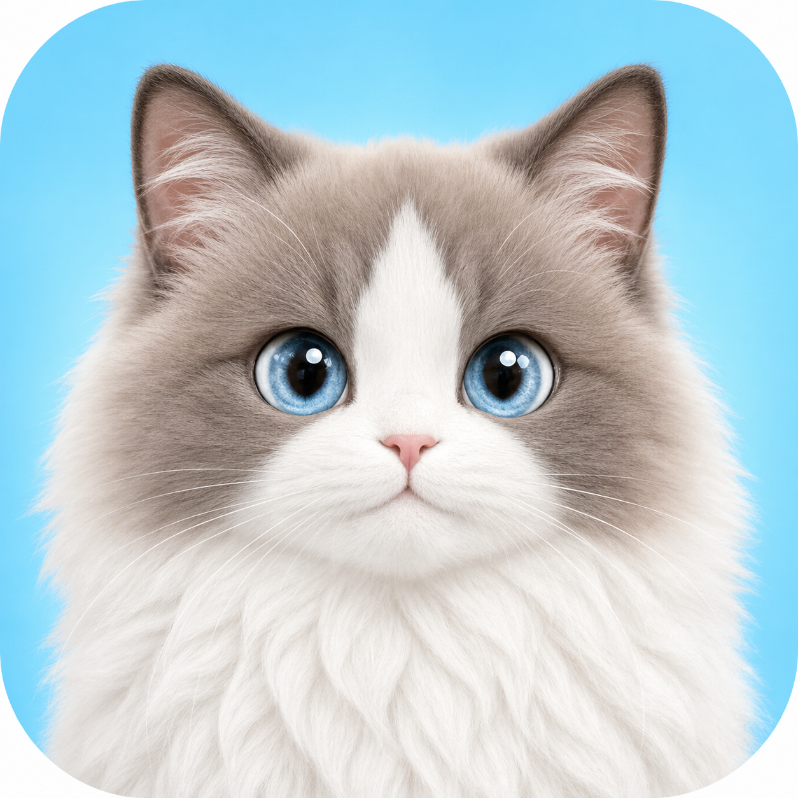
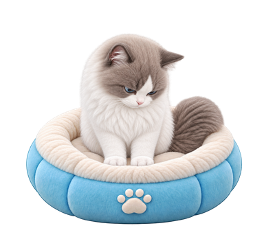
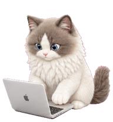
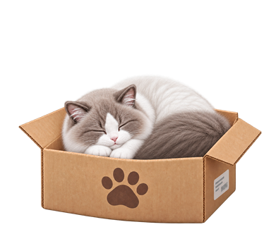

<p align="center">
  
</p>

<h1 align="center">Suannai Floating Pet / 酸奶悬浮宠物</h1>

<p align="center">
  <strong>A fluffy little coding companion for Codex.</strong><br />
  <strong>陪你和 Codex 一起工作的软萌小猫。</strong>
</p>

[English](#english) · [简体中文](#简体中文)

<p align="center">
  
  &nbsp;&nbsp;
  
  &nbsp;&nbsp;
  
</p>

## English

A native macOS floating desktop pet that keeps you company while you work with Codex. Suannai types alongside you, asks for your attention when Codex needs approval, and earns fish when a task finishes. Open her shop to pick out a bed or dress up the energy bar and fish counter with a matching skin.

### Features

- Native AppKit/SwiftUI transparent always-on-top window
- Displays the remaining usage in Codex's 7-day window
- Random work animations, including typing, checking an iPhone, and drinking Coca-Cola
- Approval-request alerts and task-completion bubbles
- Grooming, sleeping, and exhausted idle states based on remaining usage
- Three click-interaction animations plus visual drag feedback
- Adjustable pet size from 75% to 150%, saved automatically

### Fish, shop and inventory

Click the fish counter beside the energy bar to open the shop, or right-click Suannai and choose **酸奶的小店**. The energy bar shows the remaining Codex weekly allowance. You can hide it with **显示能量条** in the right-click menu and still use the fish counter to enter the shop.

Each task completion that Suannai detects earns **1 fish**. Petting her also has a 15% chance to award 1–3 fish per eligible click, with at least 10 minutes between petting rewards and up to five such rewards per local day.

| Item | Price in fish | How it works |
| --- | --- | --- |
| Chicken / tuna can | 2 / 4 | Suannai eats the can as soon as you buy it. |
| Yarn ball / laser pointer | 8 / 25 | Choose **玩一下** in the inventory to play again. |
| Cardboard box / soft cushion | 12 / 25 | Each bed has its own idle, grooming, sleeping and exhausted animations. |
| Cream Candy / Minimal Mint / Paw Energy | 60 each | Each skin styles both the energy bar and the fish counter. Shop cards preview the pair. |

New beds and skins equip immediately. Open the inventory (**仓库**) to switch between purchases, put a bed away (**收回**), or restore the default skin (**恢复默认**). A bed and a skin can be equipped together. Your balance, inventory and selections are saved on this Mac.

### Requirements

- Apple Silicon Mac
- macOS 14 or later
- Codex for macOS installed
- Xcode Command Line Tools with the macOS 15.4 SDK used by the build script

### Build and Run

```bash
chmod +x build-app.sh
./build-app.sh
open "build/酸奶悬浮宠物.app"
```

The built application will be available at `build/酸奶悬浮宠物.app`. The build script compiles directly with the system `swiftc` and does not modify your development environment.

### Privacy and Data

Suannai reads task activity and weekly usage from the local Codex app-server. It does not upload this data to any third-party service.

### License

The Swift source code and build scripts are available under the [MIT License](LICENSE). The cat character, animation frames, icons, and other visual assets are not covered by the MIT License. See [ASSETS-LICENSE.md](ASSETS-LICENSE.md) for details.

---

## 简体中文

酸奶是一只住在 macOS 桌面上的小猫。你用 Codex 时，她会陪你敲键盘，在需要授权时提醒你，任务完成后还能攒小鱼干。点开酸奶的小店，可以给她挑个窝，也可以给能量条和小鱼干计数一起换肤。

### 功能

- 原生 AppKit/SwiftUI 透明置顶窗口
- 显示 Codex 7 天窗口的剩余用量
- 工作、玩手机、喝可口可乐等随机工作动画
- 授权请求提醒与任务完成气泡
- 根据剩余用量切换梳毛、睡觉和疲惫待机状态
- 三种点击互动动画与拖动反馈
- 75%–150% 宠物尺寸调节，并自动记忆设置

### 小鱼干、商店与仓库

点击能量条旁的小鱼干余额，就能打开商店。也可以右键点击酸奶，选择**酸奶的小店**。能量条显示 Codex 本周剩余用量，在右键菜单里关闭**显示能量条**后，仍可点击小鱼干逛店。

酸奶每检测到一次任务完成，就会发放 **1 条小鱼干**。摸摸酸奶也能获得奖励：符合条件的点击有 15% 的概率获得 1–3 条，两次摸摸奖励至少间隔 10 分钟，每个本地自然日最多领 5 次。

| 商品 | 价格（条） | 用法 |
| --- | --- | --- |
| 鸡肉罐头 / 金枪鱼罐头 | 2 / 4 | 买下后酸奶会立即吃掉。 |
| 毛线球 / 激光笔 | 8 / 25 | 在仓库点「玩一下」，可以反复和酸奶玩。 |
| 快递纸箱 / 柔软坐垫 | 12 / 25 | 每个窝都有专属的待机、梳毛、睡觉和疲惫动画。 |
| 奶油软糖 / 极简薄荷 / 猫爪电量 | 每款 60 | 能量条和小鱼干计数一起换肤，商品卡上可以预览整套效果。 |

猫窝和皮肤买下后会自动换上，两者可以同时使用。打开**仓库**即可免费切换已拥有的款式，还可以「收回」猫窝或把皮肤「恢复默认」。余额、藏品和当前搭配都会保存在这台 Mac 上。

### 环境要求

- Apple Silicon Mac
- macOS 14 或更高版本
- 已安装 Codex macOS 应用
- Xcode Command Line Tools，构建脚本使用 macOS 15.4 SDK

### 构建与运行

```bash
chmod +x build-app.sh
./build-app.sh
open "build/酸奶悬浮宠物.app"
```

构建完成的应用位于 `build/酸奶悬浮宠物.app`。脚本使用系统 `swiftc` 直接编译，不会修改系统开发环境。

### 隐私与数据

酸奶通过本机 Codex app-server 获取任务状态和周用量，不会把这些数据上传到任何第三方服务。

### 许可证

Swift 源码与构建脚本采用 [MIT License](LICENSE)。猫咪形象、动画帧、图标及其他视觉素材不包含在 MIT 授权范围内，详见 [ASSETS-LICENSE.md](ASSETS-LICENSE.md)。
